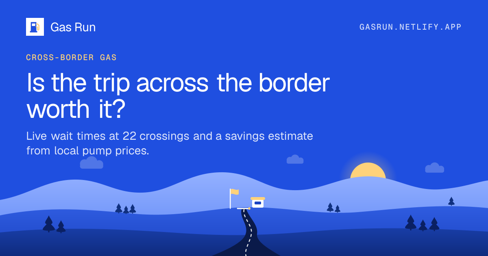
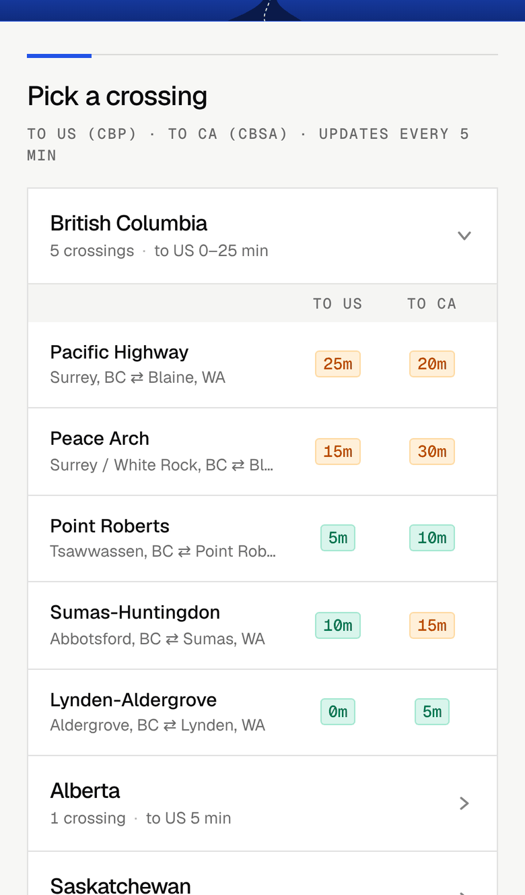
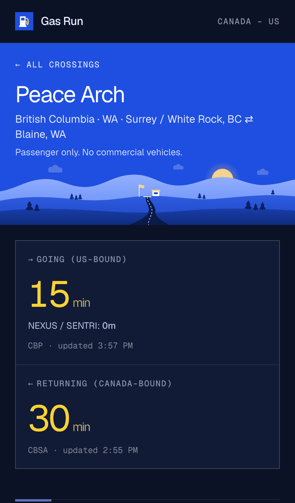
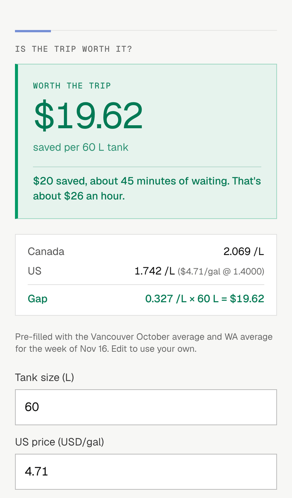

<p align="center">
  <a href="https://gasrun.netlify.app">
    
  </a>
</p>

<h1 align="center">Gas Run</h1>

<p align="center">
  <strong>Is the trip across the border worth it?</strong><br>
  Live wait times at 22 Canada–US crossings, weighed against what you'd save on a tank of gas.
</p>

<p align="center">
  <a href="https://gasrun.netlify.app"><strong>gasrun.netlify.app</strong></a>
  &nbsp;·&nbsp;
  <a href="https://gasrun.netlify.app/cameras">Border cameras</a>
  &nbsp;·&nbsp;
  <a href="#how-it-works">How it works</a>
</p>

---

Locals along the 49th parallel call it a *gas run*: drive south, fill up, drive home.
Whether it pays off depends on two numbers that change all the time, the price gap
and the line at the border. Gas Run puts both on one screen for your crossing and
gives you a straight answer.

<table>
  <tr>
    <td align="center" width="33%"></td>
    <td align="center" width="33%"></td>
    <td align="center" width="33%"></td>
  </tr>
  <tr>
    <td align="center"><sub><b>Pick a crossing</b><br>Grouped by province, both directions at a glance</sub></td>
    <td align="center"><sub><b>See the line</b><br>Going and returning waits, NEXUS included</sub></td>
    <td align="center"><sub><b>Get a verdict</b><br>Dollars saved against minutes waited</sub></td>
  </tr>
</table>

## Features

- **Live wait times both ways.** US-bound from CBP, Canada-bound from CBSA, refreshed every five minutes, with NEXUS/SENTRI lanes where reported.
- **A wait-aware verdict.** Savings per tank are divided by the round-trip wait. Anything under **$20 saved per hour in line** is flagged *Marginal*, so a $15 saving behind a 90-minute queue doesn't look like a win.
- **Local prices, not national ones.** Each crossing is paired with its nearest surveyed Canadian city (Vancouver, Toronto, Thunder Bay, Ottawa-Gatineau and more) and the matching US state or region.
- **Live border cameras.** Current stills from DriveBC, WSDOT and 511NY on crossing pages where available, plus a dedicated [cameras page](https://gasrun.netlify.app/cameras).
- **Your numbers win.** Tank size, US price and Canadian price are prefilled but editable, and your tank size is remembered.
- **Built for the car park.** Mobile-first, light and dark themes, and the wait times sit above the fold on a phone.
- **Share cards.** Every crossing has its own link preview, so a link dropped in a group chat shows which crossing it is.

## How it works

```
   CBP XML feed ──┐                                  ┌── crossing page
  CBSA CSV feed ──┼── fetched server-side, cached ───┤      waits + verdict
ExchangeRate-API ─┘      5 min (waits), 1 h (FX)     └── homepage accordion

 StatCan 18-10-0001 ──┐   weekly GitHub Action    ┌── prices.generated.ts
 EIA weekly retail ───┴── scripts/refresh-prices ─┴── (commit, or PR if a price moves >15%)
```

| Data | Source | How often |
|---|---|---|
| US-bound waits | U.S. Customs and Border Protection, Border Wait Times | Every 5 minutes |
| Canada-bound waits | Canada Border Services Agency, Border Wait Times | Every 5 minutes |
| Canadian pump prices | Statistics Canada, table 18-10-0001 (regular, self serve, by city) | Monthly survey, checked weekly |
| US pump prices | U.S. EIA, Weekly Retail Gasoline Prices | Weekly |
| USD → CAD | ExchangeRate-API | Hourly |

The savings maths is deliberately plain: convert the US price from USD per gallon to
CAD per litre, take the gap to the Canadian price, multiply by your tank. The verdict
then divides that by the total minutes you'd spend waiting (going plus returning) to
get dollars per hour.

Pump prices are refreshed by a [GitHub Action](.github/workflows/refresh-prices.yml)
every Tuesday. Routine changes are committed straight to `main`; any price that moves
more than 15% in a week is opened as a pull request for a human to check first.

**What it can't do (yet).** Prices are regional averages, not station prices, since
there is no public GasBuddy API. Several border states (Michigan, Montana, North
Dakota, Vermont, New Hampshire, Maine) aren't in any weekly EIA series, so they use
their regional average, which can be off by a few dollars a tank.

## Tech stack

- [Next.js 16](https://nextjs.org) (App Router, server components, ISR) and TypeScript
- [Tailwind CSS v4](https://tailwindcss.com)
- Link-preview cards rendered with `next/og`, using the Geist typeface
- The border scene is SVG drawn in code, so there are no image assets to ship
- Python for the price-refresh script, GitHub Actions to run it
- Hosted on [Netlify](https://www.netlify.com)

## Run it locally

You need Node 22 and a free API key from [ExchangeRate-API](https://www.exchangerate-api.com/).

```bash
git clone https://github.com/mfscifly/gas-run.git
cd gas-run
cp .env.example .env.local     # then add your EXCHANGE_RATE_API_KEY
npm install
npm run dev                    # http://localhost:3000
```

Other commands:

```bash
npm run build                               # production build
npm run lint
python3 scripts/refresh-prices.py           # rewrite price defaults from StatCan + EIA
python3 scripts/refresh-prices.py --check   # exit 1 if the defaults are stale
```

Crossings live in [`src/data/crossings.ts`](src/data/crossings.ts). To add one, give it a
CBP port number and a CBSA office name; either can be `null` and the page degrades
gracefully. [`CLAUDE.md`](CLAUDE.md) has the longer tour of the codebase and its gotchas.

## Data sources

The code is MIT licensed (see [LICENSE](./LICENSE)). The data it pulls in is not
covered by that licence and stays under its publishers' terms:

- **Canadian pump prices:** Statistics Canada, Table 18-10-0001-01, "Monthly
  average retail prices for gasoline and fuel oil, by geography". Adapted from
  Statistics Canada under the
  [Statistics Canada Open Licence](https://www.statcan.gc.ca/en/terms-conditions/open-licence).
  This does not constitute an endorsement by Statistics Canada of this product.
- **US pump prices:** U.S. Energy Information Administration, Weekly Retail
  Gasoline and Diesel Prices. U.S. government work, public domain.
- **US-bound wait times:** U.S. Customs and Border Protection, Border Wait Times
  feed. U.S. government work, public domain.
- **Canada-bound wait times:** Canada Border Services Agency, Border Wait Times,
  under the [Open Government Licence – Canada](https://open.canada.ca/en/open-government-licence-canada).
- **Border camera stills:** linked live from DriveBC, WSDOT and 511NY at view
  time. No images are stored in this repository; each belongs to its agency.
- **Fonts:** Geist, under the SIL Open Font License (`src/assets/fonts/OFL.txt`).

Gas Run is an independent project and is not affiliated with any of these agencies.
Wait times and prices are estimates; check before you drive.

## Licence

[MIT](./LICENSE).

---

<p align="center"><sub>Built by Daniel</sub></p>
